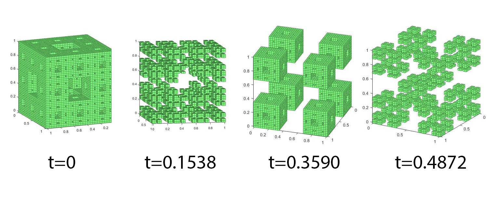

# Formalization of Sierpinski's Carpet and Similar Fractals in 2D and Higher Dimensions

LaTeX source for the article *"Formalization of Sierpinski's carpet and similar fractals in 2d and higher"* by M. F. Hamza Ryad (April 12, 2017).



## Abstract

Fractals are interesting mathematical objects, with the peculiar properties of self-similarity and non-integer Hausdorff dimension. Such objects are generated using diverse methods. The starting point of this article, Sierpinski's carpet, is a fractal that is traditionally described using an iterated function system. In this article, we discuss the construction of a formal definition in relation to coordinates and the iteration stage; thus treating the fractal as a set of points. We then generalize both in shapes, diversity and dimensions.

The advantages of this method are:
- An easy implementation.
- Generalization and variations.
- Robust description for higher-dimensional versions.
- Access to area calculation by integrating such a formula at a defined iteration.
- Direct calculation of the Minkowski dimension.

## Overview

The paper formalizes Sierpinski's carpet as a union of centered, evenly arranged square cuts. At iteration $n$, the number of cuts is $3^{2(n-1)}$ and the side of each cut is $\frac{1}{3^n}$ of the primary square's side. Cuts are regarded as an interference pattern of square waves (values 0 = void, 1 = solid), intersected across consecutive iterations by multiplication.

The construction uses a cosine-based square wave:
$$
\frac{1}{2}\left(\operatorname{sgn}\left(\cos(2\pi x 3^{n-1})+\cos\left(\frac{\pi}{3}\right)\right)+1\right)\in\{0,1\}
$$
combined as an interference of a wave along $x$ and another along $y$. The method is then generalized to higher-dimensional versions ($S_{2,2}^d$), including Sierpinski's triangle and its higher-dimensional relatives, with Minkowski dimension computed directly, e.g. $\frac{\log(d+1)}{\log 2}$ for the family $S_{2,2}^d$.

## Contents

- `file.tex` — main LaTeX source (article class, `amsmath`, `amssymb`, `amsthm`, `graphicx`, `hyperref`)
- `images/` — 23 figures (`img-000.jpg` … `img-022.jpg`) extracted from the source PDF
- `web/index.html` — example interactive 3D implementation (Three.js) of the formalization: Sierpinski carpet / Menger sponge / higher sponges in 2D–6D, with presets, slice controls and Minkowski dimension readout
- `matlab/` — MATLAB implementations of the paper's formalization (cosine/sine square-wave families, 2D–5D)

## MATLAB implementations

The `matlab/` folder contains MATLAB scripts that implement the paper's formalization:

**Core — cosine/sine families matching the paper:**
- `sarpienskicos.m` — 2D Sierpinski carpet (cosine family `Cᵏᵖᵈ`)
- `sarpienskisin.m` — 2D Sierpinski carpet (sine family `Sᵏᵖᵈ`)
- `sarpienskicos3D.m` — 3D Menger sponge (d=3)
- `sarpienskicos4D.m` — 4D Menger sponge (d=4)
- `sarpienskicos5D.m` — 5D Menger sponge (d=5)

**Variants / experiments:**
- `hamzcos.m`, `boxcos.m`, `sarpienskicospi.m`, `sarpienskicose.m`, `pilin.m`, `cantor.m`

### Dependency note

`sarpienskicos3D.m` calls **`PATCH_3Darray.m`** to render the 3D voxel array. That file is **not** included in this repository. It was written by Adam H. Aitkenhead (The Christie NHS Foundation Trust, 2010) and must be obtained separately — see the comment header inside `sarpienskicos3D.m` for details.

## Interactive web implementation

`web/index.html` is a self-contained Three.js example that renders the formalization interactively:

- Sierpinski carpet (d=2), Menger sponge (d=3), and higher Menger sponges (d=4–6)
- Presets: `C₃,₃²`, `C₃,₃³`, `C₃,₃⁴`, `C₅,₅²`, `C₅,₅³`, `S₂,₂²`, `S₂,₂³`
- Custom family (cosine/sine), grid, iterations, slice sliders for d>3
- Live Minkowski dimension readout (`log N / log k`)

Open `web/index.html` directly in a browser (it loads Three.js from a CDN, so an internet connection is needed on first load).

## Build

```bash
pdflatex file.tex
```

The `.tex` does not currently contain `\includegraphics` calls or a `\graphicspath`, so the images are included as reference material. To embed them, add to the preamble:

```latex
\graphicspath{{images/}}
```

and insert figures with:

```latex
\includegraphics{img-000}
```

## License

This repository contains a reformatted LaTeX transcription of the article. Please respect the original author's copyright.
